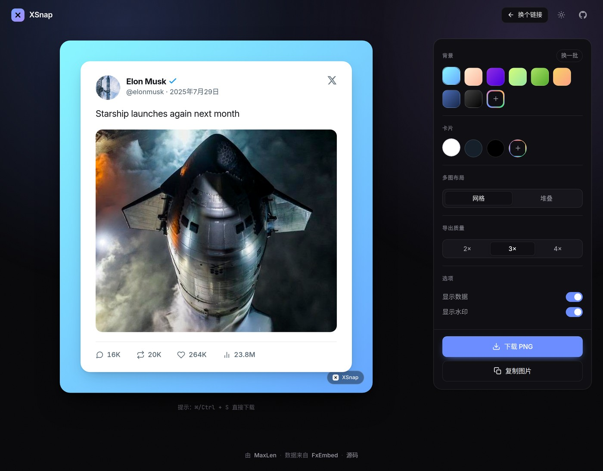

<div align="center">


# XSnap

**Turn any post into an image worth sharing.**

Paste a link → get a clean, high-resolution card. No screenshots, no cropping.

**[→ Open the live demo](https://maxlen727.github.io/XSnap/)**

</div>



---

## What it is

XSnap is a browser-only tool that turns a public Twitter/X link into a shareable
image. Quotes, threads, multi-image layouts and stats are all handled for you.
Nothing is uploaded anywhere — the page talks to the [FxEmbed](https://github.com/FxEmbed/FxEmbed)
API for the data, renders the card in your browser, and hands you back a PNG.

It's a single static page. No build step, no framework, no bundle — `index.html`
plus three files in `assets/`. That's the whole deploy.

## Features

| | |
|---|---|
| **Card styles** | Light / Dim / Dark, or any custom colour — text contrast is computed for you |
| **Backgrounds** | 8 gradients, plus a custom two-colour picker |
| **Media layout** | Grid or stacked, 1–4 images, cropped consistently |
| **Quoted posts** | Rendered inline, including their own media |
| **Threads** | Click "show post above" to walk up the reply chain, one card at a time |
| **Export quality** | 2× / 3× / 4× |
| **Options** | Show or hide stats, show or hide the watermark |
| **Output** | Download PNG, or copy straight to the clipboard |
| **Interface** | English / 中文, automatic light–dark theme |
| **Keyboard** | `⌘/Ctrl + S` downloads, `Esc` goes back |

Deep links work too: `?url=<post link>` opens straight into the editor.

## How it works

```
x.com link  →  api.fxtwitter.com/{user}/status/{id}  →  card DOM  →  html2canvas-pro  →  PNG
```

The card is real DOM, not canvas drawing — so the layout you see is the layout you
get, and styling it is ordinary CSS.

### Two things worth knowing before you touch the renderer

`html2canvas` re-implements CSS layout rather than using the browser's, and two
gaps will bite you:

1. **It ignores `object-fit`.** Images come out stretched. So every media cell is
   an `overflow:hidden` box with an absolutely positioned `` whose size and
   offset are computed from the photo's real dimensions (`coverCell()` in `main.js`).
2. **It ignores `gap` on flex containers.** Spacing between cells is done with
   explicit margins.

Also: media cells are sized in **pixels**, not percentages, which is why the card
has to be visible and laid out before media is measured. If a card is rendered
while hidden it measures `0` and retries on the next frame.

## Development

```bash
python3 -m http.server 8080   # or any static server
# → http://localhost:8080
```

There's nothing to install and nothing to compile. Edit a file, reload.

For scripting or embedding, the page exposes a small hook:

```js
XSnap.generate('https://x.com/user/status/123')  // load a post
XSnap.download()                                 // save the current card
XSnap.copyImage()                                // copy the current card
```

## Known limits

- Protected accounts and deleted posts can't be fetched — that's the API, not the page.
- Very long posts make very tall images. That's the point, but 4× on a long thread is a big file.
- Some browser privacy modes block the CDN requests; images then fall back to an
  [allOrigins](https://github.com/gnuns/allorigins) proxy, which is slower.
- X keeps changing its markup; when the API shape moves, `buildCard()` is where to look.

## Credits

- **[FxEmbed / FxEmbed](https://github.com/FxEmbed/FxEmbed)** — the data source. This project is a front-end for it.
- **[html2canvas-pro](https://github.com/yorickshan/html2canvas-pro)** — DOM → canvas, with modern colour support.
- **[allOrigins](https://github.com/gnuns/allorigins)** — proxy fallback when images get blocked.
- **[Inter](https://rsms.me/inter/)** & **[JetBrains Mono](https://www.jetbrains.com/lp/mono/)** — type.
- **Gemini** — wrote the original version of this, back in the early days of vibe coding.

## Changelog

### 2025 · Redesign

A ground-up rebuild of the interface. Same job, done properly this time.

- New visual language: one design system, light and dark from the same tokens
- Editor is now a two-pane tool — preview on the left, controls on the right
- Card rebuilt: verified badge, post date, real icons instead of emoji, better
  media grids, larger type, proper quoted-post layout
- Custom card colours now compute text contrast, so light cards on dark colours
  (and the reverse) stay readable
- `html2canvas` → `html2canvas-pro`; images are cropped by hand instead of being
  stretched by the missing `object-fit`
- Export quality selector (2× / 3× / 4×), copy-to-clipboard, watermark and stats toggles
- Sticky action bar, keyboard shortcuts, `?url=` deep links, toast notifications
- Responsive down to phone width; the whole app fits on one screen again

### 2025-08-11 · Previous version

Quoted post rendering, reply-chain walking, stats toggle, mobile pass, and a pile
of `main.js` fixes. Also written by Gemini.

---

<div align="center">
<sub>Built by <a href="https://github.com/maxlen727">MaxLen</a></sub>
</div>
